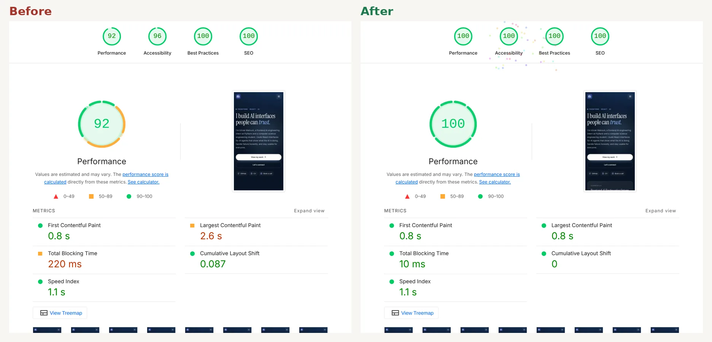
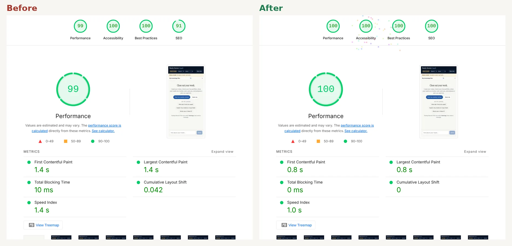
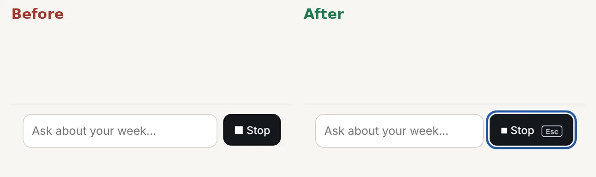
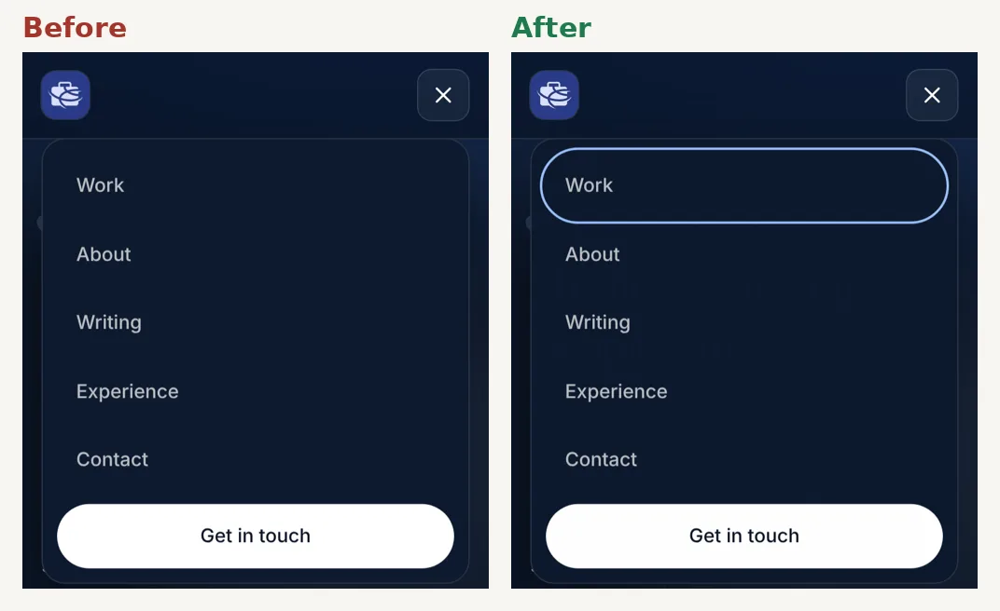
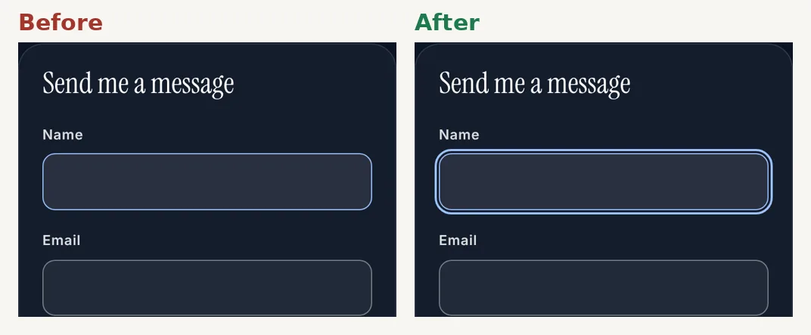
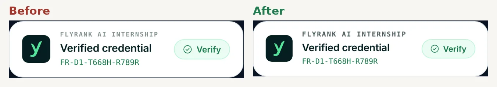

# FE-10 Accessibility and performance audit

Ichrak Matrouh · FlyRank Frontend AI Engineering · Build (polish) · 18 November 2026
Page version: https://ichrak-matrouh.vercel.app/audit/

**Result:** Lighthouse mobile is **100 for performance and 100 for accessibility on all 10 audited pages**, including the AI chat. The rubric asks for 90 and accepts 80. axe-core and my WAVE-style checker find **0 errors** on every page. The primary flow, chat included, now works **from the keyboard alone**. Focus no longer drops to the page body at any step. Streamed answers are **announced politely in whole sentences** instead of one update per token.

Most of my pages already scored 100 in Lighthouse, so the bigger findings came from the keyboard pass and the screen reader check. Lighthouse can't see either of those.

---

## 1. What I audited and how

| | |
|---|---|
| Pages | Home `/` (primary flow: menu, case studies, contact form), the AI chat (Weekly Review Coach, the live app linked from `/agent-build/`, `/tool-ui/` and `/edge-cases/`), and every case-study page: `/tool-ui/`, `/edge-cases/`, `/testing/`, `/3d/`, `/playground/`, `/agent-build/`, `/agent-spec/`, `/cv/` |
| Primary flow | Home → open the menu → reach a case study → send a message through the contact form. Then the chat: start a weekly review, stop an answer mid-stream, send again, approve next week's plan, open and close a notes file, upload notes |
| Lighthouse | 13.6.0, **mobile preset** (Moto G Power emulation, simulated slow 4G, 4× CPU slowdown). Home and chat: median of 3 runs. Other pages: 1 run each |
| WAVE | My cloud container can't run the WAVE browser extension, so `scripts/fe10/wave-lite.mjs` re-implements WAVE's error rules and its common alerts (see section 3). axe-core 4.14 runs alongside it, with the WCAG 2.2 A/AA and best-practice rules, at phone and desktop widths |
| Keyboard | Scripted keyboard-only runs (`scripts/fe10/kbd-*.mjs`). Playwright presses Tab, Shift+Tab, Enter and Escape and never clicks. After every step it logs where focus is and whether a focus ring shows |
| Screen reader | A recorder logs every text change inside a live region (`aria-live`, `role=log/status/alert`) during one full weekly review. That is what a screen reader would be asked to say |
| Where | The production build, served the way Vercel serves it (gzip, clean URLs, same headers). My cloud container can't reach `*.vercel.app`. **Before** = `main` at `c1f44f9`; **after** = this branch |

I used the AI assistant as the brief says. It read each Lighthouse, axe and keyboard log and proposed a fix. I re-ran the same audit after every fix, and a fix counted only once the finding was gone. Two of its first proposals didn't work:
- Keeping the focus fix in the chat as it was first written didn't work. React reused the same DOM button for Send and Stop, so focus stayed on a button that had become disabled. Giving the two buttons separate keys fixed it.
- The first keyboard script reported the file dialog as "opens with focus lost". The real cause was the script: on a phone the files are behind a toggle. The script now opens the toggle first, so the before and after numbers compare the same steps.

## 2. Lighthouse, before → after (mobile)

| Page | Performance | Accessibility | Best practices | SEO | LCP | TBT | CLS |
|---|---|---|---|---|---|---|---|
| Home `/` (median of 3) | 92 → **100** | 96 → **100** | 100 | 100 | 2.6 s → 0.8 s | 220 ms → 0 ms | 0.087 → 0 |
| Coach chat, live app (median of 3) | 99 → **100** | 100 | 100 | 91 → **100** | 1.5 s → 0.8 s | 40 ms → 70 ms | 0.041 → 0 |
| FE-07 `/tool-ui/` | 100 | 100 | 100 | 100 | 0.9 s → 0.9 s | 10 ms → 0 ms | 0 → 0 |
| FE-08 `/edge-cases/` | 100 | 100 | 100 | 100 | 0.9 s → 1.0 s | 10 ms → 0 ms | 0 → 0 |
| FE-09 `/testing/` | 100 | 100 | 100 | 100 | 0.9 s → 0.9 s | 10 ms → 0 ms | 0.024 → 0 |
| FE-AA2 `/3d/` | 98 → **100** | 100 | 100 | 100 | 0.9 s → 0.9 s | 160 ms → 20 ms | 0 → 0 |
| FE-05 `/playground/` | 100 | 100 | 100 | 100 | 0.8 s → 0.8 s | 0 ms → 0 ms | 0 → 0 |
| Agent build `/agent-build/` | 100 | 100 | 100 | 100 | 0.9 s → 0.9 s | 10 ms → 0 ms | 0 → 0 |
| Agent spec `/agent-spec/` | 100 | 100 | 100 | 100 | 0.9 s → 0.9 s | 0 ms → 0 ms | 0 → 0 |
| CV `/cv/` | 100 | 100 | 100 | 100 | 0.8 s → 0.8 s | 0 ms → 0 ms | 0 → 0 |

Home, three runs before: 92, 88, 97 (LCP 2.4 to 3.0 s, CLS 0 to 0.087). Three runs after: 100, 100, 100 (LCP 0.8 s every time, CLS 0). The chat's TBT moves between 0 and 70 ms from run to run, both before and after, so treat it as noise.





Full reports (HTML and JSON, before and after, every page) are in the project files under `fe10-audit/lighthouse/`.

## 3. What WAVE-style checks, axe and the keyboard pass found

### WAVE-style checks (`wave-lite.mjs`)
Errors: missing alt, linked image without alt, empty link, empty button, empty heading, missing form label, broken ARIA reference, broken skip link, missing page language, missing title. Alerts: skipped heading level, no h1, no `<main>`, redundant adjacent links, positive tabindex, `<noscript>`, alt text over 150 characters, text under 10 px, justified text. I also added one check of my own: new-tab links that don't say so.

| | Before | After |
|---|---|---|
| **Errors** | **3**: broken ARIA references on `/playground/` (tabs and disclosure pointed `aria-controls` at panels that were not rendered) | **0** on all 10 pages |
| Alerts | 34: 9 `<noscript>`, 2 alt texts over 150 characters, 1 text under 10 px (badge label, 9 px), 22 new-tab links not announced | **1, justified**: one `<noscript><style>` on home. It only turns off the scroll fade-in when JavaScript is off, so the prerendered page stays readable |

### axe-core (WCAG 2.2 AA + best practices, phone and desktop)
| | Before | After |
|---|---|---|
| Home | `color-contrast` (serious): the badge's "FlyRank AI Internship" label, 3.3:1. `label-content-name-mismatch` (serious): the badge link's `aria-label` didn't contain its visible text | clean |
| 6 case-study pages | `region` (moderate): the closing "Try it" section was outside `<main>` | clean |
| Chat | `region` (moderate) ×2: the demo and offline banners were outside every landmark | clean |
| Playground, CV | clean | clean |

### Keyboard-only pass, the primary flow
| Step | Before | After |
|---|---|---|
| Chat: first Tab | Lands on the Week picker. No skip link | "Skip to the message box" |
| Chat: focus ring | Browser default, 1 px dark, nearly invisible on the navy header | 3 px ring: blue on light areas, sky on the navy header |
| Chat: press **Send** with Enter | Focus drops to `<body>` | Focus moves to **Stop** |
| Chat: press **Stop** with Enter | Focus drops to `<body>` | Focus returns to the message box |
| Chat: **Escape** while streaming | Nothing | Stops the answer (`aria-keyshortcuts="Escape"`, and the button shows "Esc") |
| Chat: answer finishes | Focus drops to `<body>` | Focus returns to the message box, but only if it was lost. It never takes focus from somewhere else |
| Chat: approve the plan | Focus drops to `<body>` | Moves to Stop while the reply streams, then back to the message box |
| Chat: upload notes | **Not reachable**: the file input was `hidden` | Reachable. The label shows the focus ring |
| Chat: file dialog | Tab leaves the dialog. Escape drops focus to `<body>` | Focus is kept inside the dialog. Escape returns focus to the file button that opened it |
| Home: open the menu, then Tab | **Skips the whole menu**: the links came before the button in the DOM | Goes to "Work", the first link |
| Home: Escape in the open menu | Nothing | Closes it, and focus goes back to the button |
| Home: focus ring on dark sections | Blue on navy, **2.6:1** (a focus indicator needs 3:1) | Sky on navy, about 9:1 |
| Home: contact form fields | `outline: none`, only a 1 px border colour change | 2 px ring |
| Home: Send message | Focus drops to `<body>` (the button became `disabled`) | Stays on "Sending…" (`aria-disabled`), then moves to the "Message sent." heading |
| Home: "Send another message" | Focus drops to `<body>` | Moves to the Name field |







## 4. AI-specific accessibility

### Streamed output, announced politely
**Before:** the conversation was `role="log"`, which is a polite live region. Each tool card was its own `aria-live="polite"` region as well. The answer arrives a few characters at a time, so a screen reader was asked to say **174 updates during one weekly review**: "Let", "Let me", "Let me start", "Let me start with" … "See whi", "See which not" … Screen readers either drop most of these or read fragments.

**After** (`weekly-review-coach/src/a11y.tsx`):
- The conversation keeps `role="log"`, but now has `aria-live="off"` and `aria-busy` while streaming. Tool cards are no longer live regions.
- **One** visually hidden `aria-live="polite"` region speaks for the chat:
  - "Coach is answering." when the request goes out,
  - the answer in **whole sentences**, at most one batch every 1.5 s, with markdown symbols stripped,
  - each tool step once, when it settles ("Read a file: done.", "Check live portfolio: failed."),
  - "Next week's plan is ready. Approve it or ask for changes." when the plan is waiting for me,
  - whatever is left of the answer when the stream ends, or "Stopped. Anything that arrived is kept." after Stop.
- Errors keep `role="alert"`, because they need attention now.

Result: **174 → 10 announcements** for the same weekly review. None is a sentence fragment.

### A keyboard-reachable stop button
Stop was already in the tab order, right after the message box. What was broken was focus around it. Now:
- Pressing Send moves focus to Stop. Stop and Send are separate elements (`key`), so neither swap leaves focus on a dead node.
- **Escape stops the answer from anywhere on the page**, unless a dialog is open, in which case Escape closes the dialog. The shortcut is announced (`aria-keyshortcuts`) and shown on the button.
- After Stop, focus returns to the message box, and "Stopped. Anything that arrived is kept." is announced.
- The "taking longer than usual" Stop does the same.

New tests in `weekly-review-coach/tests/unit/a11y.test.tsx` cover this. The announcer never reads half a sentence. Send by Enter → focus on Stop → Escape → stopped, and focus is back in the message box. The upload input is focusable.

## 5. Every change

| Area | Change | Fixes | Verified by |
|---|---|---|---|
| Fonts, all pages | Self-hosted Inter (variable) and Instrument Serif instead of Google Fonts, both main fonts preloaded, `font-display: swap`. Arial and Times fallback faces are resized to the real fonts' metrics (`size-adjust`, ascent and descent overrides) | Layout shift when the fonts swap in (home CLS 0.087), an extra third-party origin before first paint | CLS 0 on every page |
| Home | **Prerendered at build time** (`scripts/prerender.mjs`, `renderToString`), then hydrated. The hero is no longer hidden behind the scroll fade-in | LCP 2.6 s: the hero only painted after React ran and the fade-in started | LCP 0.8 s, 3 of 3 runs. Hydration gives no console errors |
| Home | Without JavaScript, the full prerendered page now shows; this replaces the short `<noscript>` summary | Week 9 no-JS fallback was a summary only | Page renders with JS off |
| Home | Menu button moved before the links it opens; Escape closes the menu | Tab skipped the open menu | Keyboard pass |
| Home | Focus ring uses sky on the dark sections; contact fields get a real ring | Focus ring 2.6:1 on navy; fields had `outline: none` | Keyboard pass, screenshots |
| Home | Contact form: `aria-disabled` while sending, focus moves to "Message sent." and back to Name | Focus lost twice during a send | Keyboard pass, updated test |
| FlyRank badge | Label colour `#4A5A5C` (7:1) instead of 50 % opacity (3.3:1), 9 px → 10 px. The link's name is now its visible text, plus "(opens … in a new tab)" | axe `color-contrast`, `label-content-name-mismatch` | axe, updated test |
| Images | 80 px WebP logo for the 40 px header logo (5.3 KB → 1.2 KB). CI screenshots as WebP with `width` and `height` (90 → 43 KB). Two alt texts shortened | Oversized image, unsized images (Lighthouse), WAVE long-alt alerts | Lighthouse, WAVE-style |
| 6 case-study pages | The closing "Try it" section moved inside `<main>` | axe `region` | axe |
| All pages | New-tab links say "(opens in a new tab)" to screen readers | Unannounced context change | WAVE-style |
| Playground | Every tab panel and the disclosure panel always rendered (`hidden` when closed) | WAVE error: broken ARIA reference ×3 | WAVE-style |
| Chat | Streamed-output announcer, Stop focus, Escape, focus return (section 4) | Section 4 | New unit tests, keyboard pass |
| Chat | Skip link, a visible 3 px focus ring, upload input reachable, focus kept inside the file dialog and returned on close, banners in a "Notices" landmark | Keyboard pass, axe `region` | Keyboard pass, axe |
| Chat | Space reserved for the demo banner while `/api/status` answers | CLS 0.041: the chat jumped down when the banner arrived | CLS 0 in 3 of 3 runs |
| Chat, JS weight | Messages (markdown parser, sanitizer, tool cards) moved to their own chunk, fetched when the browser is idle | 498 KB of JS loaded up front, 307 KB of it unused at load | Up-front JS 498 → 423 KB (149 → 124 KB gzipped) |
| Chat | `robots.txt` | SEO 91: the app returned HTML for `/robots.txt` | SEO 100 |



## 6. What is left, and why

- **"Reduce unused JavaScript"** is still listed as an opportunity, worth about 60 KB on the portfolio pages and about 300 KB on the chat. On the portfolio it is React DOM itself. On the chat it is React DOM, the AI SDK and Zod, which the AI SDK uses to check every streamed chunk. The scores are already 100, and replacing those libraries would cost more than it saves.
- **The `/3d/` network scene** is still an 860 KB chunk, about 233 KB gzipped. It was already lazy-loaded behind a poster image, and phones tap to load it (FE-AA2), so it doesn't affect the page's Lighthouse score.
- **Numbers on the live site.** My container can't reach `*.vercel.app`, and the PageSpeed API is over quota from here, so every number above comes from the production build served locally the Vercel way. Running PageSpeed Insights (mobile) on the live URLs after the merge would confirm them.
- **The live chat needs a redeploy.** The chat app's Vercel project isn't linked to Git yet, so its fixes reach https://weekly-review-coach.vercel.app only after the preview deployment is promoted.
- **No real screen reader.** I didn't test with VoiceOver or NVDA. The announcer was checked by recording what the live regions say, not by listening. A 5-minute VoiceOver run on an iPhone is the next step.

## 7. Re-run it

```bash
npm run build                        # portfolio, with the prerender
cd weekly-review-coach && npx vite build && cd ..
node scripts/fe10/serve.mjs dist 4300                             # portfolio, served like Vercel
npx tsx scripts/fe10/serve.mjs weekly-review-coach/dist 4400 ./weekly-review-coach   # chat + its API (demo model)
npx lighthouse http://localhost:4300/ --view        # mobile is the default; or Chrome DevTools > Lighthouse > Mobile
node scripts/fe10/axe.mjs http://localhost:4300 http://localhost:4400 axe.json
node scripts/fe10/wave-lite.mjs http://localhost:4300 http://localhost:4400 wave.json
node scripts/fe10/kbd-home.mjs http://localhost:4300/ after
node scripts/fe10/kbd-coach.mjs http://localhost:4400/ after
```
The scripts need Playwright, and `axe.mjs` needs `axe-core` (`npm i -D axe-core`).
