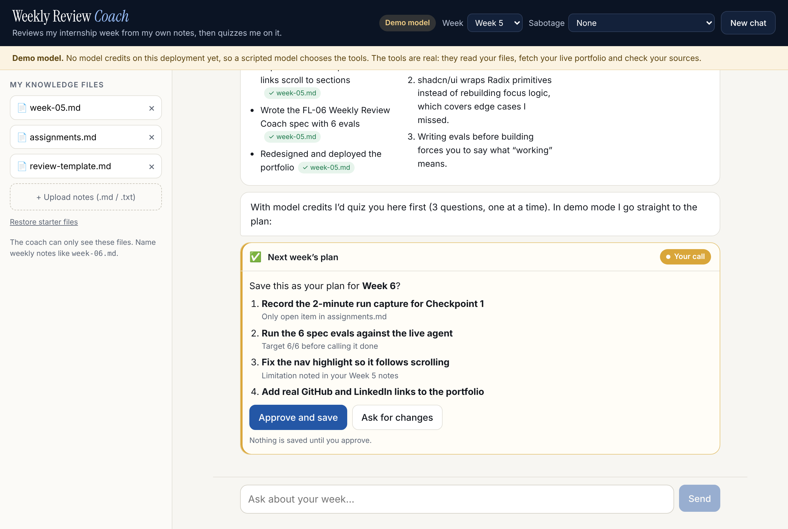
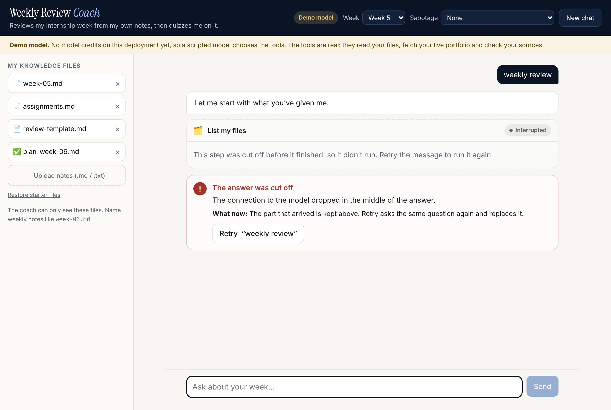
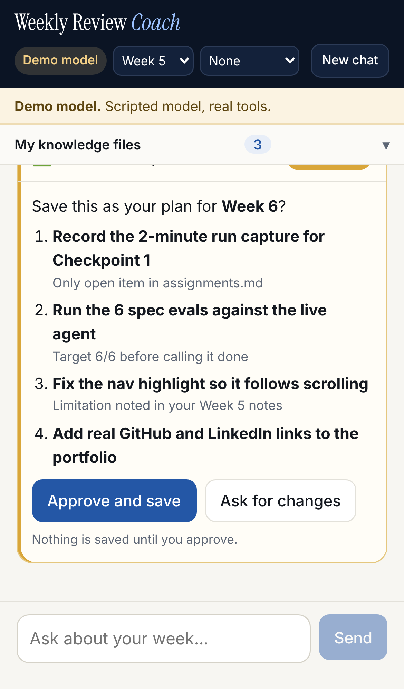

# Weekly Review Coach

**Live:** https://weekly-review-coach.vercel.app

A chat agent that reviews my internship week from my own notes. Ask "How did my week go?" and it reads the week's notes file, checks what the assignment list says is due, compares that with what is actually live on my portfolio, and proposes next week's plan, which you approve or push back on before it is final. Every tool call is shown as a real component with its own loading, running, done and error state, not as JSON.

| Review with tool cards | Error mid-answer, with retry | Phone |
|---|---|---|
|  |  |  |

## Run it locally

Needs Node 20+.

```bash
git clone https://github.com/nadouch123/ichrak-portfolio
cd ichrak-portfolio/weekly-review-coach
npm install
npm run dev:full        # app + /api on http://localhost:5180
```

No key is needed: without one, the app runs a scripted demo model (marked with a "Demo model" badge) that makes the same tool calls Claude would, and the tools run for real. Add a key in `.env` to talk to Claude.

```bash
npm test                # Vitest unit + component tests (no model is ever called)
npm run test:e2e        # Playwright, mocks the AI route
npm run build           # production build into dist/
```

## Environment variables

| Name | Required | Default | What it does |
|---|---|---|---|
| `ANTHROPIC_API_KEY` | No | none | Turns on the real model. Without it (and without the gateway flag) the demo model answers. |
| `COACH_MODEL` | No | `claude-opus-5-5` | Model id sent to Anthropic (or `anthropic/claude-opus-5.5` with the gateway). |
| `COACH_USE_GATEWAY` | No | off | Set to `1` to go through the Vercel AI Gateway instead of a direct key. |
| `COACH_RATE_LIMIT` | No | `20` | Requests per IP per 10 minutes before `/api/chat` answers 429. |

On Vercel, set these under Project → Settings → Environment Variables for **Production** and redeploy.

## Architecture

```
Browser (React 19, @ai-sdk/react useChat)
   │  POST /api/chat  { messages, files, week }
   ▼
api/chat.ts  (Vercel function, maxDuration 60 s)
   ├─ guards: JSON parse, empty input, 2,000-char message cap,
   │          40-message cap, 20 files x 60 KB, per-IP rate limit
   ├─ pickModel(): Claude │ AI Gateway │ scripted demo model
   └─ streamText(tools, stopWhen 10 steps) ──► UI message stream (SSE)
          tools (lib/tools.ts, Zod schemas):
            listFiles / readFile ── week notes (attached or public/data)
            checkPortfolio ── fetches the live portfolio pages
            showWeeklyReview ── renders the review card
            proposePlan ── no execute: the user's Approve answers it
   ▼
src/ToolParts.tsx renders each tool part by state;
src/failures.tsx turns every error into a designed message with a next step.
```

## Production hygiene

- **Input caps:** one message is at most 2,000 characters, a conversation at most 40 messages, attachments at most 20 files of 60 KB. Bigger requests get a 413 with a plain message.
- **Rate limit:** 20 requests per IP per 10 minutes (`lib/rate-limit.ts`), answered with 429 and `retryAfter`. It is in memory, so it is per warm function instance: it stops a stranger looping the endpoint, not a determined attacker. A shared store (Upstash/KV) would be the next step if the key gets real traffic.
- **Cost ceiling:** `maxDuration = 60` (in the route and `vercel.json`), at most 10 model steps per answer, and the client's Stop aborts the model call through `req.signal`.
- **No key in the browser:** the key only lives in the function's environment.

## Decisions

- **Demo model as the default.** Reviewers can try the whole flow without me paying per visit, and the tests never touch a real model. The badge makes it impossible to mistake for Claude.
- **Human approval on the plan.** `proposePlan` has no `execute`; the UI's Approve button supplies the result, so the agent can never "decide" next week on its own.
- **Errors are content, not crashes.** Every failure (network, rate limit, cut-off stream, bad tool input, refusal) leaves the route as a JSON problem the UI can explain. The sabotage switches in the UI exist so each can be shown on demand.
- **Vite + Vercel functions, not Next.js.** The app is one page and one route; a framework would add more than it gives.

## How AI tools built this

I directed the work; Claude (Claude Code, in a project with one thread per assignment) wrote most of the code. Specifically:

- **Spec first (FL-06):** I wrote the agent design spec with Claude's help: the three tools, the approval step, what "good" looks like. The code follows that spec.
- **Generated by Claude:** the route, tool definitions, the four tool-part states, the demo model, the failure layer (FE-08), the test suite (FE-09), the accessibility fixes (FE-10) and the rate limit in this pass.
- **What I had to correct:** the first version printed tool results as raw JSON; I asked for real components per tool. The first error screens said "Something went wrong"; I asked for what failed, what it was trying to do and what to do now. The screen reader announced every streamed token (174 announcements in one answer) until the audit caught it; it is now 10.
- **What AI could not check:** it cannot open github.com or vercel.app from its sandbox, so CI screenshots and the final cross-browser pass (Safari, Firefox, iPhone) were done by me.
- **Honest gap:** the evals in the spec have only been run against the demo model, not Claude, because the deployed app has no API key yet.

---

# Deep dive: tool states and failure handling

## The state machine

Each state answers a different question, so each one gets its own visual treatment:

```
                 model starts a tool call
                          │
                          ▼
              ┌──────────────────────┐
              │   input-streaming    │  "What is it doing?"
              │  dashed border,      │  tool name, "Writing the request…",
              │  pulsing pill        │  the reason as it streams in, and a
              └──────────┬───────────┘  skeleton shaped like the result
                         │ input complete (Zod-valid)
                         ▼
              ┌──────────────────────┐
              │   input-available    │  "With what input?"
              │  blue edge,          │  "Why this tool", input chips, spinner
              │  "Running" pill      │  (proposePlan: amber "Your call" card
              └─────┬──────────┬─────┘   with Approve / Ask for changes)
       execute ok   │          │  execute throws / user rejects input
                    ▼          ▼
  ┌──────────────────────┐  ┌──────────────────────┐
  │   output-available   │  │     output-error     │
  │  settled card,       │  │  red edge + head,    │
  │  green "Done" pill   │  │  "!" mark            │
  │  "What came back?"   │  │  "What went wrong?"  │
  │  a real component    │  │  what failed, what it│
  │  per tool            │  │  was trying to do,   │
  └──────────────────────┘  │  what to do now,     │
                            │  Try again           │
                            └──────────────────────┘
```

The body of each part is keyed by its state, so every transition plays a 200 ms crossfade (opacity, a small lift and blur) instead of swapping. `prefers-reduced-motion` turns it off.

The error state was designed first. You can trigger it two ways in the UI:

1. **Sabotage** (header select): "readFile fails" or "checkPortfolio fails" makes that tool throw on purpose.
2. **Week 6**: there is no `week-06.md`, so `readFile` throws "There is no file called…". The coach then asks for the notes instead of reviewing an older week.

A failed request (network, model) gets its own designed card with Try again, not a crash.

## Tool contract

All inputs are Zod schemas. Every field has a `.describe()`. Each tool takes a short `reason` that the UI shows as "Why this tool", which is the "choosing" moment made visible.

`reason`: `string, max 140`: one short sentence telling the user why the tool is being called now.

### `listFiles` (server)

| | |
|---|---|
| Input | `{ reason }` |
| Returns | `{ files: { name: string; kind: 'notes' \| 'assignments' \| 'template' \| 'plan' \| 'other'; chars: number; week: number \| null }[] }` |
| Errors | none |
| UI result | file chips with a kind badge and size |

### `readFile` (server)

| | |
|---|---|
| Input | `{ name: string /* exact file name, e.g. "week-05.md" */, reason }` |
| Returns | `{ name: string; kind: string; lines: number; content: string }` |
| Errors | `There is no file called "X". Files you have: …` · simulated failure (test switch) |
| UI result | file preview with kind badge, first lines, "Show the whole file" |
| UI error | "File not found" + "Upload week-XX.md in the side panel, then try again" |

### `checkPortfolio` (server, real network)

| | |
|---|---|
| Input | `{ reason }` |
| Returns | `{ site: string; checkedAt: string /* ISO */; pages: { path: string; ok: boolean; status: number \| null; ms: number; title: string \| null }[] }` |
| Errors | throws only when **every** page fails (6 s timeout each); a single failed page comes back as `ok: false` |
| UI result | "4/4 pages online" + SVG bar chart of response time per page (failed pages in red) |

### `showWeeklyReview` (server, verifies sources)

| | |
|---|---|
| Input | `{ week: int 1–52; finished: { item: string ≤120; source: string }[] ≤8; learned: string ≤160 [exactly 3]; open: { title: string ≤100; due: string ≤20 }[] ≤8; conflict?: string ≤200 }` |
| Returns | the input, plus `finished[].verified: boolean` (is `source` one of my files?) and `unverified: number` |
| UI result | review card: Finished with ✓/? source badges, Learned, Still open with due pills |
| Missing optional fields | no `conflict` → no banner at all; empty `finished`/`open` → a plain sentence ("Nothing marked as finished in your notes."), never an empty box; `unverified > 0` → amber warning |

### `proposePlan` (client: user interaction)

| | |
|---|---|
| Input | `{ week: int 1–52; items: { task: string ≤100; why?: string ≤120 }[] 1–5 }` |
| Output schema | `{ approved: boolean; savedAs?: string; feedback?: string }` |
| No `execute` | the browser answers with `addToolOutput` after I click **Approve and save** (writes `plan-week-XX.md` into my files) or **Ask for changes** (sends my feedback). Nothing is saved before that. `sendAutomaticallyWhen: lastAssistantMessageIsCompleteWithToolCalls` then lets the model continue. |
| Missing optional fields | items without `why` render as a single line |

## Failure, empty and edge cases (FE-08)

Every failure leaves the server as a small JSON problem `{ code, message, retryAfter? }` (see `lib/failures.ts`), and the browser turns each code into a designed state (`src/failures.tsx`). Nothing shows a raw stack trace or an HTML error page.

### Sabotage checklist

Pick one under **Sabotage** in the header, then send a message. Each switch breaks the **next request only** and then turns itself off, so Retry shows the recovery.

| # | Sabotage | What breaks | What you should see | Recovery |
|---|---|---|---|---|
| 1 | Network down before send | `fetch` throws before the request leaves | "Couldn’t reach the coach", message kept | Retry “…” re-sends the same message |
| 2 | Connection drops mid-stream | the model stream errors after ~14 chunks | partial text kept, cut tool card marked **Interrupted**, "The answer was cut off" | Retry replaces only the failed reply |
| 3 | Rate limit (429) | route returns 429 + `Retry-After: 12` | "Too many requests", button counts down "Retry in 12s" | unlocks itself |
| 4 | Tool returns malformed JSON | `readFile` payload is cut in half, `JSON.parse` fails | tool card **Failed**: "Unreadable tool result"; coach explains and stops | Try again |
| 5 | Route handler throws (500) | an exception inside `POST` | "The server hit an error" (JSON 500, not an HTML page) | Retry |
| 6 | Slow response (9 s) | 9 s before the first token | skeleton bubble; after 5 s "This is taking longer than usual" with **Stop** | Stop keeps what arrived; "Ask again" |
| 7 | Model refuses | answer ends with `finishReason: content-filter` | "The model declined to answer this" + Edit my question | rephrase |
| 8 | readFile fails | tool throws | tool card **Failed** with what it was trying to do | Try again |
| 9 | checkPortfolio fails | tool throws | tool card **Failed**; review continues without it | Try again |
| 10 | Page component crashes | a component throws while rendering | chat-level boundary: "The chat stopped working", files untouched | Reload the chat |

Also handled without a switch: the device going offline (banner + Send paused), empty input (Send disabled, Enter shows a hint, server returns `empty_input`), input over 2,000 characters (counter, Send disabled, server returns 413 `too_long`), a malformed request body (400), damaged saved data in localStorage (validated on load; the top-level boundary offers "Reset saved data"), starter files that fail to load (designed error + Try again), and `/api/status` failing ("Model status unknown").

Real provider errors map to the same states: 429 → rate limit with the provider’s `Retry-After`, 529/"overloaded" → "The model is busy", 401/403 → "can’t reach its model" (no retry button, since retrying can’t help).

### The retry button

- It says what it will retry: **Retry “weekly review”** (the failed message, not the whole conversation). It calls `regenerate()`, which drops the failed reply and re-sends the last user message.
- It can’t fire twice: it disables itself on the first click and shows "Retrying…"; a double click sends one request (asserted in the e2e test).
- For a rate limit it counts down from `Retry-After` and unlocks itself.

### Empty states

| Where | When | What it offers |
|---|---|---|
| Chat | first run | **Start my weekly review**, **Quiz me**, and three "Or try asking" examples that fill the composer on click |
| Chat | no files loaded | "Nothing to review yet." + **Load the example notes** / **Upload my notes** |
| Chat | selected week has no notes file | warning naming the missing file + **Switch to Week 5** |
| Side panel | no files | "No files yet." + **Load example notes** |
| listFiles result | empty list | points to the side panel instead of an empty box |

### Pending states

- Model badge: a pill skeleton while `/api/status` loads.
- Files: three file-shaped skeletons while the starter files load.
- Chat: "Coach is choosing what to do" + a bubble-shaped skeleton (same padding as a reply bubble, so nothing jumps when the reply arrives). Tool cards keep their own result-shaped skeletons from FE-07.

### Mobile Safari

`100dvh` (with `100vh` fallback) instead of `100vh`; `interactive-widget=resizes-content` so the keyboard resizes the layout instead of covering the input; 16 px textarea so iOS doesn’t zoom; `env(safe-area-inset-bottom)` under the composer; `overscroll-behavior` so rubber-band scrolling stays inside the chat; auto-scroll only while you are already at the bottom (otherwise a **↓ Latest** button), so it never fights your thumb; files collapse into a toggle and the header fits on one row at 390 px.

### Tests (FE-09)

Vitest + React Testing Library for components, Playwright for the main flow. Every test queries by role, label or visible text, never by class or test id, so restyling can't break them. The AI route is always mocked: component tests replace `fetch` and fail on any request they did not expect; the Playwright test answers `/api/chat` with `page.route`; route tests use the scripted demo model.

```bash
npm test                   # Vitest: chat states, message renderer, tool results, route
npm run test:e2e           # Playwright: start review → tools run → review card → approve plan → plan saved
npm run test:e2e:sabotage  # FE-08 browser check against the real route (needs npm run dev:full)
```

| File | What it covers |
|---|---|
| `tests/unit/chat-states.test.tsx` | the whole chat against a mocked route: pending, streaming (text and a tool arriving chunk by chunk), 429, mid-stream cut + Retry once, failed tool, input guards |
| `tests/unit/message-view.test.tsx` | the message renderer, every part type: user text, sanitized markdown, skipped parts, each tool state, contained render crash |
| `tests/unit/tool-results.test.tsx` | tool result components: review card, file preview, site chart, plan approval |
| `tests/unit/route.test.ts` | the `/api/chat` handler's designed failures |
| `e2e/weekly-review.spec.ts` | the primary flow in Chromium |
| `tests/support/ui-stream.ts` | builds UI-message-stream responses for the mocks, shared by Vitest and Playwright |

CI: `.github/workflows/tests.yml` at the repo root runs all of this on every push.

## Files

```
api/chat.ts         POST: streamText with the tools, stopWhen stepCountIs(10)
api/status.ts       GET: which model is active (live or demo)
lib/tools.ts        the tool definitions (this assignment's deliverable)
lib/system.ts       system prompt
lib/demo-model.ts   scripted MockLanguageModelV4 for when there are no model credits
lib/failures.ts     problem codes, error mapping, sabotage middleware (FE-08)
src/failures.tsx    error boundaries, ChatError with retry, offline + slow hooks (FE-08)
tests/              Vitest suites + shared stream mocks (FE-09)
e2e/                Playwright primary flow + the FE-08 sabotage check
src/MessageView.tsx one chat message, part by part
src/ToolParts.tsx   the four states (+ Interrupted) + result components (FilePreview, SiteChart, ReviewCard, PlanDecision)
src/App.tsx         useChat, knowledge files panel, test switches
scripts/dev-server.ts  local server for app + api
```
